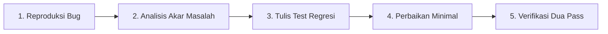

# Command: /fix-bug

> **Tujuan**: Memperbaiki bug atau kerusakan fungsionalitas secara terstruktur, terisolasi, dan terverifikasi tanpa memicu efek samping (*side effects*).

---

## Alur Prosedur Kerja (5 Langkah)



### Langkah 1: Reproduksi Bug
1. Identifikasi laporan bug atau gejala error yang dilaporkan pengguna.
2. Tentukan langkah reproduksi minimal (*minimal reproduction steps*).
3. Jalankan pengujian atau jalankan alur aplikasi untuk melihat bug muncul secara nyata.

### Langkah 2: Analisis Akar Masalah (Root Cause Analysis)
1. Selidiki sumber penyebab masalah menggunakan log atau stack trace.
2. Identifikasi mengapa bug tersebut bisa terjadi (asumsi data salah, edge case tak tertangani, atau *type mismatch*).
3. Rumuskan hipotesis perbaikan yang presisi tanpa berspekulasi.

### Langkah 3: Tulis Test Regresi (Regression Test First)
1. **Wajib sebelum menyentuh kode perbaikan**: Tulis kasus uji unit test atau integration test baru yang mereplikasi bug tersebut.
2. Jalankan test runner dan buktikan bahwa test regresi ini **GAGAL (MERAH)** karena keberadaan bug.

### Langkah 4: Terapkan Perbaikan Minimal
1. Terapkan perubahan kode seminimal mungkin untuk membuat test regresi menjadi **LULUS (HIJAU)**.
2. **Dilarang melakukan refactoring skala besar** di luar scope perbaikan bug ini.
3. Pastikan tidak ada fungsi yang membengkak melebihi batas 40 baris.

### Langkah 5: Verifikasi Dua Pass & Sinkronisasi
1. **PASS 1 (Fungsional)**: Jalankan seluruh test suite, linter, dan build untuk memastikan tidak ada fitur lain yang rusak.
2. **PASS 2 (Kepatuhan)**: Audit `git diff` terhadap `docs/RULES.md` dan `docs/STRUCTURE.md`.
3. Laporkan hasil dengan format penutup wajib:
   ```text
   Pass 1: [hasil test, lint, build].
   Pass 2: [hasil evaluasi DoD].
   Pelanggaran ditemukan dan diperbaiki: [daftar perbaikan / tidak ada].
   ```
4. Perbarui status tugas di [docs/TASKS.md](file:///docs/TASKS.md) dan tambahkan catatan perbaikan di [docs/CHANGELOG.md](file:///docs/CHANGELOG.md) bagian *Fixed*.
