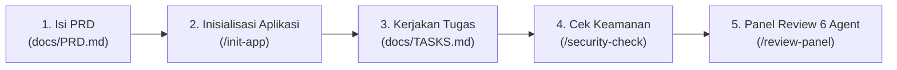

# Template PRD + MD Development Ready (Netral Stack, Hemat Token V2)

Template fondasi pengembangan perangkat lunak terstruktur untuk **vibe coding** (pengembangan bersama AI coding agent seperti Claude Code, Cursor, Codex, dan Antigravity). 

Template ini bersifat **netral terhadap teknologi/stack**. Di awal, repositori ini **hanya** berisi dokumentasi terstruktur, aturan arsitektur, konfigurasi agent reviewer, hook verifikasi, skrip pemeriksaan mekanis (`scripts/verify.sh`), dan command otomasi. Tidak ada framework, backend, frontend, atau kode aplikasi apa pun sampai Anda menginisiasinya melalui perintah `/init-app`.

---

## 🚀 Cara Menyalin Template untuk Proyek Baru

1. Buat direktori baru dan salin seluruh isi template ini:
   ```bash
   cp -r /path/to/nama-template /path/to/aplikasi-baru
   cd /path/to/aplikasi-baru
   ```
2. Pastikan file konfigurasi seperti `.claude/` dan `.gitignore` ikut tersalin.
3. Buka repositori di IDE pilihan Anda bersama AI agent Anda.

---

## 🔄 Urutan Alur Kerja Pengembangan

Ikuti 5 tahap siklus pengembangan di bawah ini:



1. **Isi PRD (`docs/PRD.md`)**:
   Lengkapi ringkasan, masalah, tujuan terukur, user stories, dan kriteria penerimaan (*Given/When/Then*) untuk semua fitur prioritas *Must*. Fitur tanpa kriteria penerimaan dilarang dieksekusi oleh agent.
2. **Inisialisasi Aplikasi (`/init-app`)**:
   Jalankan command `/init-app` di chat agent. Agent akan menganalisis PRD, mendiskusikan stack teknologi terbaik, membuat kerangka folder aplikasi terisolasi (mis. `backend/` dan `frontend/`), melengkapi placeholder dokumentasi, dan mengisi daftar tugas MVP awal di `docs/TASKS.md`.
3. **Eksekusi Tugas Bertahap (`docs/TASKS.md`)**:
   Kerjakan tugas satu per satu mengikuti **Protokol 3 Tahap** di `AGENTS.md` sesuai tingkat risiko tugas (Ringan, Normal, atau Berat).
4. **Verifikasi Keamanan Pre-Launch (`/security-check`)**:
   Sebelum rilis atau merge, jalankan `/security-check` untuk mengevaluasi kode nyata terhadap 20 checklist keamanan kritis di `docs/SECURITY.md`.
5. **Panel Evaluasi Kualitas (`/review-panel`)**:
   Jalankan `/review-panel` untuk menguji aplikasi secara independen melalui 6 persona reviewer (Strict, Awam, Kompetitor, Pelit, Profesional, Profesor).

---

## 🛠️ Pemeriksaan Mekanis Tanpa Model (`make verify`)

Template ini menyertakan `scripts/verify.sh` yang dijalankan via `make verify` (atau `bash scripts/verify.sh`). Skrip ini mengecek hal-hal mekanis secara objektif tanpa memakan token LLM:
- Memastikan file `.env` tidak ter-track di Git.
- Memindai pola secret/kredensial pada kode sumber (heuristik & gitleaks jika terpasang).
- Melarang pembuatan folder generik (`utils/`, `helpers/`, `common/`, dsb.).
- Memastikan folder `scratch/` tidak ter-track dan tidak di-import oleh kode aplikasi.
- Memastikan batas ukuran file kode maksimal 300 baris.
- Menjalankan `STACK-CHECKS` spesifik stack (diaktifkan otomatis setelah `/init-app`).

---

## 📂 Daftar Isi Dokumentasi (`docs/`)

| File | Deskripsi & Fungsi |
| :--- | :--- |
| [`PRD.md`](file:///docs/PRD.md) | *Product Requirements Document* lengkap: latar belakang, user story, kriteria penerimaan, non-goals, dan risiko. |
| [`DESIGN.md`](file:///docs/DESIGN.md) | Pedoman desain visual, integrasi `taste-skill`, mood, token desain, aksesibilitas, dan komponen UI. |
| [`STRUCTURE.md`](file:///docs/STRUCTURE.md) | **Selalu Dimuat**: Aturan penempatan file anti-repetisi, larangan folder generik, dan peta folder aplikasi (≤ 70 baris). |
| [`STRUCTURE_DETAIL.md`](file:///docs/STRUCTURE_DETAIL.md) | Detail aturan isolasi `scratch/`, seeder database, dan konvensi penamaan per folder. |
| [`RULES.md`](file:///docs/RULES.md) | **Selalu Dimuat**: Larangan keras dan checklist evaluasi *Definition of Done* bertanda [M] dan [P] (≤ 60 baris). |
| [`RULES_DETAIL.md`](file:///docs/RULES_DETAIL.md) | Detail standar gaya kode, batasan ukuran, type safety, error handling, format commit Git, dan contoh benar/salah. |
| [`TASKS.md`](file:///docs/TASKS.md) | **Selalu Dimuat**: Papan tugas aktif (Sedang Dikerjakan, Berikutnya maks 10, Diblokir) (≤ 60 baris). |
| [`TASKS_ARCHIVE.md`](file:///docs/TASKS_ARCHIVE.md) | Arsip tugas selesai dan backlog fitur MVP (tidak dimuat otomatis). |
| [`ARCHITECTURE.md`](file:///docs/ARCHITECTURE.md) | Diagram arsitektur sistem (Mermaid), modul, pemisahan lapisan, alur data, dan penanganan error. |
| [`TECH_STACK.md`](file:///docs/TECH_STACK.md) | Matriks teknologi terpilih, dependensi yang diizinkan, dan aturan penambahan library. |
| [`DATA_MODEL.md`](file:///docs/DATA_MODEL.md) | Skema entitas data, tipe field, constraint, relasi antar tabel (ERD), dan aturan migrasi database. |
| [`API_SPEC.md`](file:///docs/API_SPEC.md) | Kontrak tunggal endpoint REST/GraphQL/gRPC: format request/response, autentikasi, dan status kode. |
| [`TESTING.md`](file:///docs/TESTING.md) | Strategi pengujian (Unit, Integrasi, E2E), konvensi penamaan test, mock data, dan target coverage. |
| [`SECURITY.md`](file:///docs/SECURITY.md) | Kebijakan proteksi data, manajemen secret, dan Checklist Keamanan Pre-Launch 20 Poin. |
| [`REVIEW_PANEL.md`](file:///docs/REVIEW_PANEL.md) | Regulasi evaluasi 6 persona agent independen, kriteria kelulusan skor, dan format laporan review. |
| [`DECISIONS.md`](file:///docs/DECISIONS.md) | Catatan keputusan arsitektural (*ADR*) awal (ADR-001, ADR-002, ADR-003). |
| [`CHANGELOG.md`](file:///docs/CHANGELOG.md) | Log riwayat perubahan proyek berbasis *Keep a Changelog*. |
| [`OPTIMASI_OPSIONAL.md`](file:///docs/OPTIMASI_OPSIONAL.md) | Panduan penghematan token lanjutan (cache, targeted file reading, optimasi prompt panel review). |
