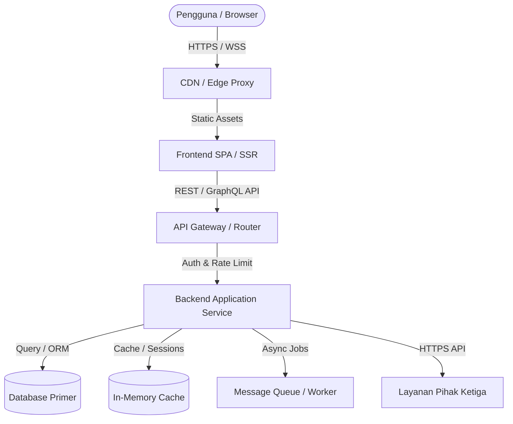
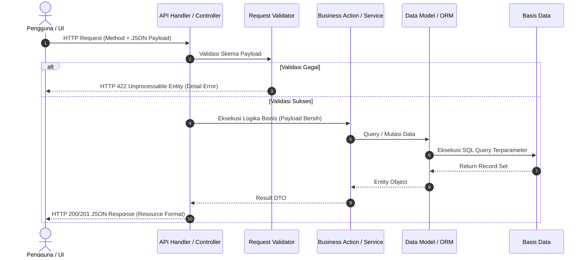

# Arsitektur Sistem (ARCHITECTURE.md)

Dokumen ini mendeskripsikan struktur arsitektur teknis sistem, batas-batas lapisan, alur data, dan mekanisme penanganan kesalahan.

---

## 1. Diagram Sistem Tingkat Tinggi (High-Level Architecture)
> *Diperbarui saat `/init-app` untuk memvisualisasikan interaksi antara pengguna, frontend, backend API, database, cache, dan layanan pihak ketiga.*

---

## 2. Lapisan & Modul Sistem
- **Lapisan Presentasi (Frontend)**: `[ISI SAAT INIT-APP: Tanggung jawab, state management, dan arsitektur rendering]`
- **Lapisan API Gateway & Routing**: `[ISI SAAT INIT-APP: Middleware auth, rate limiting, CORS, dan parsing payload]`
- **Lapisan Logika Bisnis (Application / Domain Layer)**: `[ISI SAAT INIT-APP: Isolasi use cases, orchestrator tindakan, pemisahan dari HTTP]`
- **Lapisan Akses Data (Persistence Layer)**: `[ISI SAAT INIT-APP: Model data, repositori, query builder, atau ORM]`
- **Lapisan Infrastruktur & Layanan Eksternal**: `[ISI SAAT INIT-APP: Klien email, storage provider, payment gateway]`

---

## 3. Alur Data End-to-End (Data Flow)

---

## 4. Integrasi Layanan Pihak Ketiga
| Nama Layanan | Fungsi Utama | Protokol / SDK | Strategi Fallback / Timeout |
| :--- | :--- | :--- | :--- |
| `[ISI SAAT INIT-APP: Layanan 1]` | *Autentikasi OAuth* | HTTPS OAuth 2.0 | Redirect error halaman login |
| `[ISI SAAT INIT-APP: Layanan 2]` | *Penyimpanan Objek* | S3 API Compatible | Retry exponential backoff |
| `[ISI SAAT INIT-APP: Layanan 3]` | *Notifikasi Email* | REST API (Resend/SendGrid)| Masuk antrean background job |

---

## 5. Penanganan Error & Mekanisme Logging (Error Handling & Logging)
1. **Penanganan Error Global**:
   - Seluruh unhandled exception wajib ditangkap oleh global error boundary / global exception handler.
   - Klien hanya menerima pesan error yang aman dan ramah (*sanitized error message*); tidak boleh membocorkan stack trace, struktur query, atau path file server ke klien publik.
2. **Standar Logging Terstruktur**:
   - Log server menggunakan format terstruktur (JSON) dengan level: `DEBUG`, `INFO`, `WARN`, `ERROR`, `FATAL`.
   - Setiap entri log error wajib menyertakan: timestamp UTC, correlation ID / request ID, endpoint, error stack trace terisolasi, dan user context (tanpa kredensial sensitif).
   - Dilarang keras mencatat password, token JWT utuh, nomor kartu kredit, atau data PII tanpa masking ke dalam file log.
