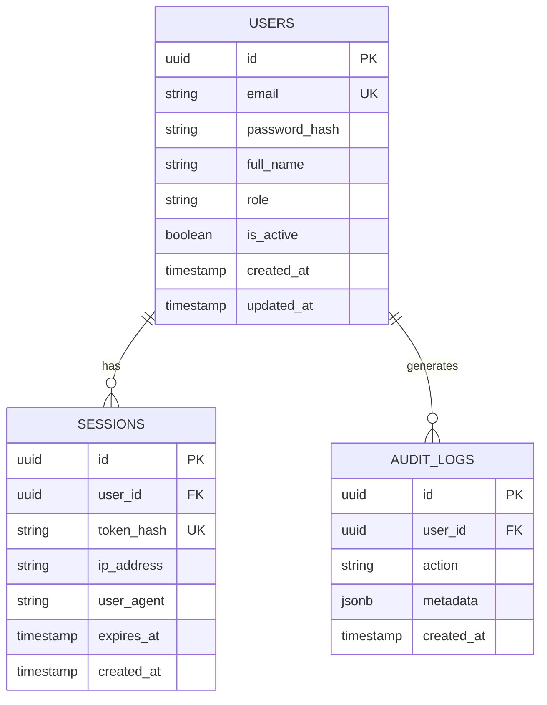

# Model Data & Skema Database (DATA_MODEL.md)

Dokumen ini mendefinisikan entitas data, tipe field, relasi, indeks performa, diagram ERD, aturan migrasi, dan seed data.

---

## 1. Diagram Relasi Entitas (Entity Relationship Diagram - ERD)
> *Diperbarui saat `/init-app` sesuai skema database aplikasi.*

---

## 2. Definisi Entitas & Skema Tabel
> *Tambahkan tabel entitas sesuai kebutuhan PRD saat `/init-app`.*

### Tabel: `users`
- **Tujuan**: Menyimpan akun pengguna terotentikasi.
- **Fields**:
  | Kolom | Tipe Data | Nullable | Default | Constraint / Indeks | Deskripsi |
  | :--- | :--- | :--- | :--- | :--- | :--- |
  | `id` | `UUID` | No | `gen_random_uuid()` | Primary Key | Identifier unik entitas |
  | `email` | `VARCHAR(255)` | No | - | Unique Index | Alamat email unik huruf kecil |
  | `password_hash` | `VARCHAR(255)` | No | - | - | Hash Argon2id / bcrypt |
  | `full_name` | `VARCHAR(100)` | No | - | - | Nama lengkap tampilan |
  | `role` | `VARCHAR(30)` | No | `'user'` | Index | Role akses: admin, user |
  | `is_active` | `BOOLEAN` | No | `true` | - | Flag status aktif |
  | `created_at` | `TIMESTAMPTZ` | No | `CURRENT_TIMESTAMP` | - | Waktu pembuatan |
  | `updated_at` | `TIMESTAMPTZ` | No | `CURRENT_TIMESTAMP` | - | Waktu modifikasi terakhir |

### Tabel Entitas Domain Tambahan
`[ISI SAAT INIT-APP: Definisi entitas-entitas bisnis aplikasi (mis. produk, transaksi, item, dsb.)]`

---

## 3. Relasi & Integritas Referensial (Foreign Keys)
- `users.id` -> `sessions.user_id` (ON DELETE CASCADE)
- `users.id` -> `audit_logs.user_id` (ON DELETE SET NULL)
- `[ISI SAAT INIT-APP: Relasi foreign key antar entitas bisnis]`

---

## 4. Strategi Indeks & Performa Query
1. **Unique Constraints**:
   - Kolom yang menjadi identifier bisnis (email, username, slug, invoice number) **wajib** memiliki indeks UNIQUE di level database.
2. **Foreign Key Indexing**:
   - Seluruh kolom Foreign Key wajib diindeks untuk menghindari *table scan* saat operasi JOIN dan CASCADE.
3. **Composite & Filtering Indexes**:
   - Kolom yang sering dijadikan filter bersamaan (mis. `status` + `created_at`) diberi indeks komposit.

---

## 5. Aturan Migrasi Database
1. **Dilarang Mengedit Migrasi yang Telah Rilis**:
   - Migrasi yang sudah berjalan di production tidak boleh diedit secara in-place.
   - Setiap modifikasi skema (tambah kolom, ubah tipe, drop indeks) wajib dibuat lewat file migrasi baru yang berurutan.
2. **Operasi Non-Destruktif & Zero Downtime**:
   - Menghapus kolom atau tabel lama dilakukan dalam dua fase rilis: (1) stop menggunakan kolom di kode, (2) drop kolom di rilis berikutnya.
3. **Rollback Support**:
   - Setiap file migrasi wajib menyediakan fungsi `down()` / pembatalan yang simetris dan teruji dapat di-rollback tanpa kegagalan.

---

## 6. Kebijakan Data Seeder
1. **Production Seeder**:
   - Hanya mengisi data lookup esensial (mis. role default, izin sistem, mata uang, negara).
   - Wajib idempotent (*firstOrCreate* atau `ON CONFLICT DO NOTHING`).
2. **Development & Testing Seeder**:
   - Mengisi data palsu realistis melalui model factory.
   - Terkunci hanya dapat berjalan jika environment adalah `local`, `development`, atau `testing`.
   - Dilarang menaruh data riil / pribadi pengguna di seeder.
