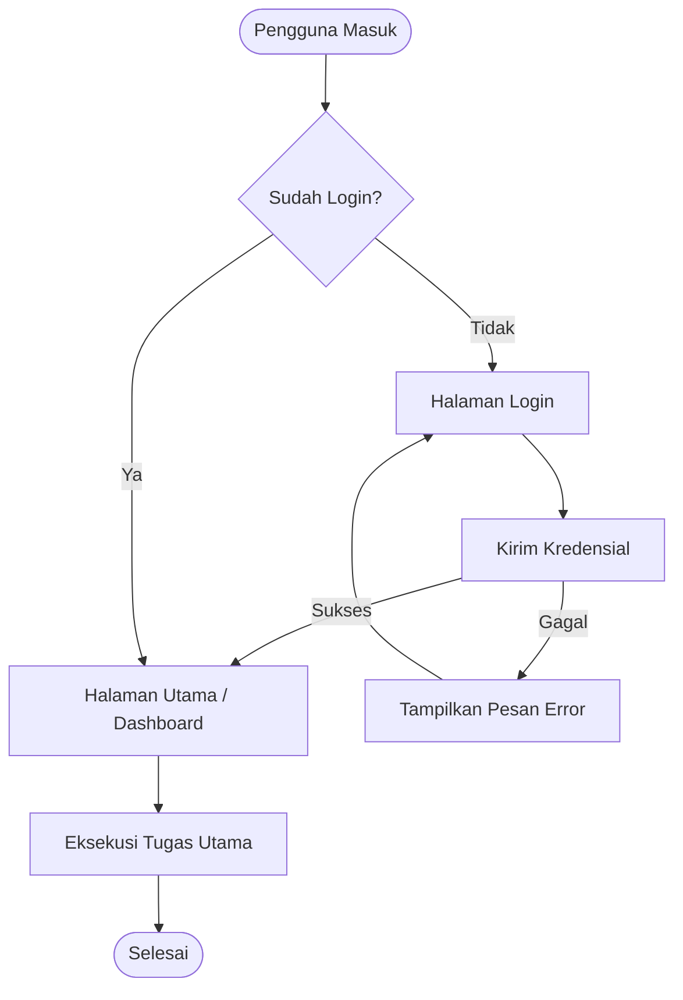

# Product Requirements Document (PRD)

> *Aturan Mutlak untuk AI Agent: Setiap fitur WAJIB memiliki kriteria penerimaan (acceptance criteria) berformat Given/When/Then yang dapat diuji. Fitur yang belum memiliki kriteria penerimaan dilarang untuk dikerjakan.*

---

## 1. Ringkasan Eksekutif
- **Nama Proyek**: *[Nama aplikasi / produk]*
- **Satu Kalimat Tujuan**: *[Satu kalimat lugas menjelaskan apa yang dibuat dan manfaat utamanya]*
- **Status Dokumen**: Draft / In Review / Approved *(Pilih salah satu)*
- **Versi**: v0.1.0
- **Tanggal Pembaruan**: YYYY-MM-DD
- **Pemilik Produk (Product Owner)**: *[Nama / Kontak]*

---

## 2. Latar Belakang & Masalah
*Jelaskan konteks masalah secara mendalam:*
- **Siapa yang mengalami kesulitan?**: *[Definisikan kelompok individu atau organisasi yang terdampak]*
- **Bukti / Data Masalah**: *[Kutipan pengguna, data metrik operasional, atau kerugian yang terjadi saat ini]*
- **Kondisi Saat Ini (Current State)**: *[Bagaimana pengguna menyelesaikan masalah tersebut sekarang tanpa aplikasi ini? Apa kelemahannya?]*

---

## 3. Tujuan Terukur (Goals & Metrics)
| Tujuan Bisnis / Pengguna | Metrik Keberhasilan (KPI) | Target Kuantitatif | Cara Mengukur |
| :--- | :--- | :--- | :--- |
| *Contoh: Mempercepat checkout* | *Checkout completion time* | *< 45 detik* | *Event logging analitik transaksi* |
| *[Tujuan 1]* | *[Metrik 1]* | *[Target 1]* | *[Instrumen pengukuran]* |
| *[Tujuan 2]* | *[Metrik 2]* | *[Target 2]* | *[Instrumen pengukuran]* |

---

## 4. Non-Goals (Batasan Ruang Lingkup)
*Sebutkan fitur atau fungsionalitas yang secara sadar dan sengaja TIDAK akan dibangun pada fase ini untuk mencegah scope creep:*
- *Bukan prioritas: [Fitur/alur X]*
- *Dikeluarkan dari rilis MVP: [Fitur/integrasi Y]*
- *Tidak didukung: [Sistem legacy / format data Z]*

---

## 5. Persona Pengguna
| Nama Persona | Peran / Jabatan | Kebutuhan Utama | Kendala / Frustrasi | Kemampuan Teknis |
| :--- | :--- | :--- | :--- | :--- |
| *Budi* | *Staff Operasional* | *Input pesanan kilat tanpa mouse* | *Koneksi sering putus, UI lambat* | *Menengah (terbiasa keyboard)* |
| *[Persona 1]* | *[Peran]* | *[Kebutuhan]* | *[Kendala]* | *Rendah / Menengah / Tinggi* |
| *[Persona 2]* | *[Peran]* | *[Kebutuhan]* | *[Kendala]* | *Rendah / Menengah / Tinggi* |

---

## 6. User Stories
- **US-01**: Sebagai *[persona]*, saya ingin *[aksi/kebutuhan]*, agar *[manfaat/nilai bisnis]*.
- **US-02**: Sebagai *[persona]*, saya ingin *[aksi/kebutuhan]*, agar *[manfaat/nilai bisnis]*.
- **US-03**: Sebagai *[persona]*, saya ingin *[aksi/kebutuhan]*, agar *[manfaat/nilai bisnis]*.

---

## 7. Daftar Fitur & Kriteria Penerimaan
> **PENTING**: Prioritas: **Must** (Wajib untuk MVP), **Should** (Penting tapi ada workaround), **Could** (Bagus jika ada waktu).

| ID | Nama Fitur | Prioritas | User Story | Kriteria Penerimaan (*Given / When / Then*) | Status |
| :--- | :--- | :--- | :--- | :--- | :--- |
| **FEAT-01** | *Autentikasi Pengguna* | Must | US-01 | **Given** pengguna belum login di halaman login, **When** memasukkan email dan password valid, **Then** sesi dibuat, token disimpan di httpOnly cookie, dan redirect ke dashboard. | Belum Mulai |
| **FEAT-02** | *Input Form Utama* | Must | US-02 | **Given** form terbuka, **When** pengguna mengirim payload dengan field wajib kosong, **Then** sistem mengembalikan HTTP 422 dengan pesan error field spesifik tanpa reload halaman. | Belum Mulai |
| **FEAT-03** | *[Nama Fitur]* | Should | US-03 | **Given** [kondisi awal], **When** [aksi pengguna], **Then** [hasil terverifikasi]. | Belum Mulai |

---

## 8. Alur Pengguna Utama (User Flows)

---

## 9. Kebutuhan Non-Fungsional (NFR)
1. **Performa**:
   - Waktu respons API p95 < 200ms.
   - First Contentful Paint (FCP) frontend < 1.5 detik pada koneksi 4G.
2. **Keamanan**:
   - Enkripsi data saat transit (TLS 1.3) dan rest (AES-256).
   - Sanitasi input bebas XSS, SQLi, dan proteksi CSRF di seluruh form mutasi.
3. **Aksesibilitas**:
   - Memenuhi standar WCAG 2.1 Level AA (kontras warna min 4.5:1, navigasi keyboard penuh, screen reader support).
4. **Privasi & Regulasi**:
   - Kepatuhan terhadap UU Perlindungan Data Pribadi (PDP) / GDPR. Penyimpanan password wajib di-hash menggunakan Argon2id atau bcrypt.
5. **Ketersediaan & Keandalan**:
   - Target ketersediaan 99.9% uptime untuk layanan inti.
6. **Perangkat & Lingkungan**:
   - Responsif pada layar mobile (375px+), tablet (768px+), dan desktop (1280px+).
   - Browser: Chrome, Firefox, Safari, Edge versi 2 tahun terakhir.

---

## 10. Data & Integrasi
- **Data yang Disimpan**: *[Sebutkan entitas inti, data profil, log aktivitas, transaksi, dll.]*
- **Sumber Data Eksternal**: *[API publik, data feed, dsb.]*
- **Layanan Pihak Ketiga**: *[Payment Gateway, Email Service (Resend/SendGrid), OAuth Provider, Object Storage (S3/R2)]*

---

## 11. Asumsi, Ketergantungan, & Risiko
| Risiko Potensial | Tingkat Dampak (H/M/L) | Kemungkinan (H/M/L) | Rencana Mitigasi |
| :--- | :--- | :--- | :--- |
| *Ketergantungan API pihak ketiga sering downtime* | High | Medium | *Implementasi circuit breaker, queue fallback, dan caching respons lokal* |
| *[Risiko 1]* | *[H/M/L]* | *[H/M/L]* | *[Strategi mitigasi]* |
| *[Risiko 2]* | *[H/M/L]* | *[H/M/L]* | *[Strategi mitigasi]* |

---

## 12. Rencana Rilis & Metrik Keberhasilan
- **Rilis MVP (Fase 1)**: Penyelesaian seluruh fitur prioritas *Must* (FEAT-01 s/d FEAT-XX) dan lolos `/security-check` serta `/review-panel`.
- **Rilis Fase 2**: Implementasi fitur *Should*, optimasi performa berdasarkan umpan balik pengguna nyata.
- **Metrik Keberhasilan Rilis**: Zero critical security bug, skor panel rata-rata >= 7.5, dan tidak ada blocker fungsional.

---

## 13. Pertanyaan Terbuka (Open Questions)
| No | Pertanyaan / Keputusan Tertunda | Pemilik Keputusan | Batas Waktu (Tenggat) |
| :--- | :--- | :--- | :--- |
| 1 | *Apakah integrasi SSO Google wajib di MVP?* | *Product Owner* | *Sebelum sprint 1 dimulai* |
| 2 | *[Pertanyaan 2]* | *[Nama]* | *[Tanggal]* |
